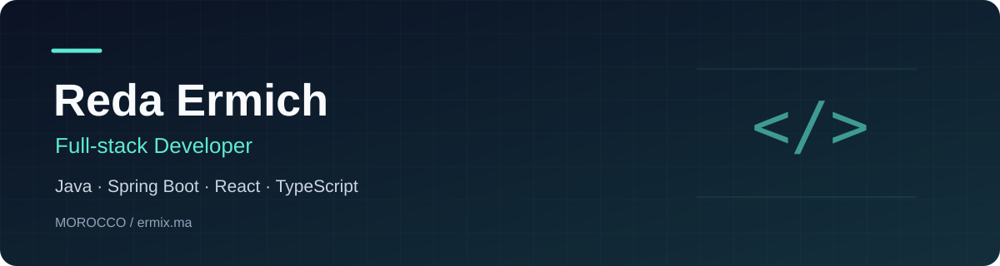

## Hey there! I'm Reda 👋

**Full-stack developer based in Morocco, focused on Java, Spring Boot, React, and TypeScript.**

I build business web applications, from backend APIs and database models to interactive interfaces. My projects explore school management, inventory tracking, and service business workflows.

### 👨‍💻 About me

- **Backend:** REST APIs, relational data modeling, and database migrations with Java/Spring Boot and PHP/Laravel.
- **Frontend:** Web interfaces with React, TypeScript, and Angular.
- **Testing:** JUnit and Testcontainers for service and database integration tests.
- **Applications:** Practical tools for managing people, stock, and everyday business operations.

### 🚀 Featured projects

| Project | What it does | Main technologies |
| :--- | :--- | :--- |
| [School Management System](https://github.com/ermix3/sb-school-app) | Manages students, teachers, courses, enrollments, and grades, with database migrations and automated tests. | Java 21 · Spring Boot · JPA · Flyway · Testcontainers |
| [Stock Management System](https://github.com/ermix3/Stock-Management-System) | Tracks inventory movements with daily entry, monthly reporting, and audit views. | React · TypeScript · Convex · Tailwind CSS |
| [Barber Shop Management](https://github.com/ermix3/barber-shop-management) | Organizes customers, services, products, and queues for a barber shop. | Next.js · React · TypeScript · Convex · Clerk |

**More to explore:** [Spring Boot testing with Testcontainers](https://github.com/ermix3/Explore-Unit-Test-Universe) · [Spring Boot + Angular appointments](https://github.com/ermix3/java-full-stack)

[Browse all public repositories →](https://github.com/ermix3?tab=repositories)

### 🛠 Tech stack

**Backend**

**Frontend**

**Databases & engineering tools**

### 🤝 Connect with me

Interested in discussing a web application, backend development, or testing? Reach me on [LinkedIn](https://www.linkedin.com/in/ermich-reda/) or [email](mailto:redaermich@gmail.com).
